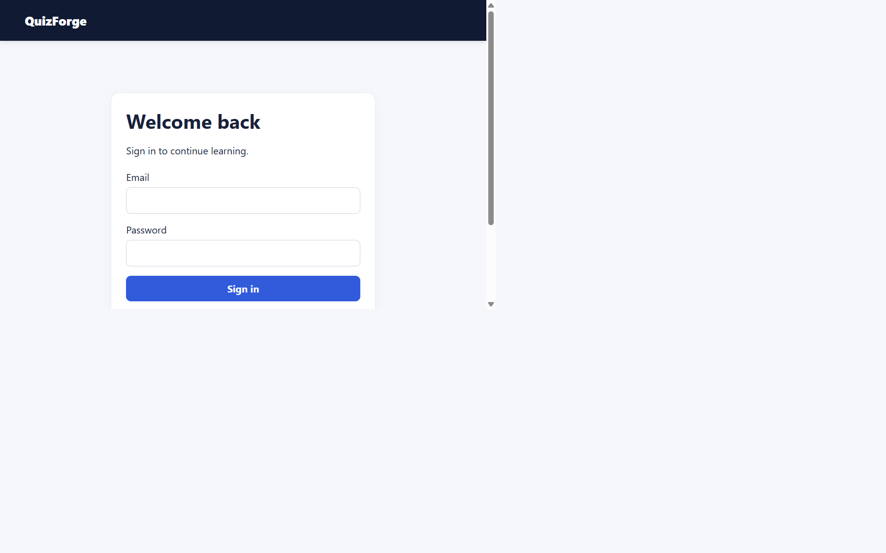
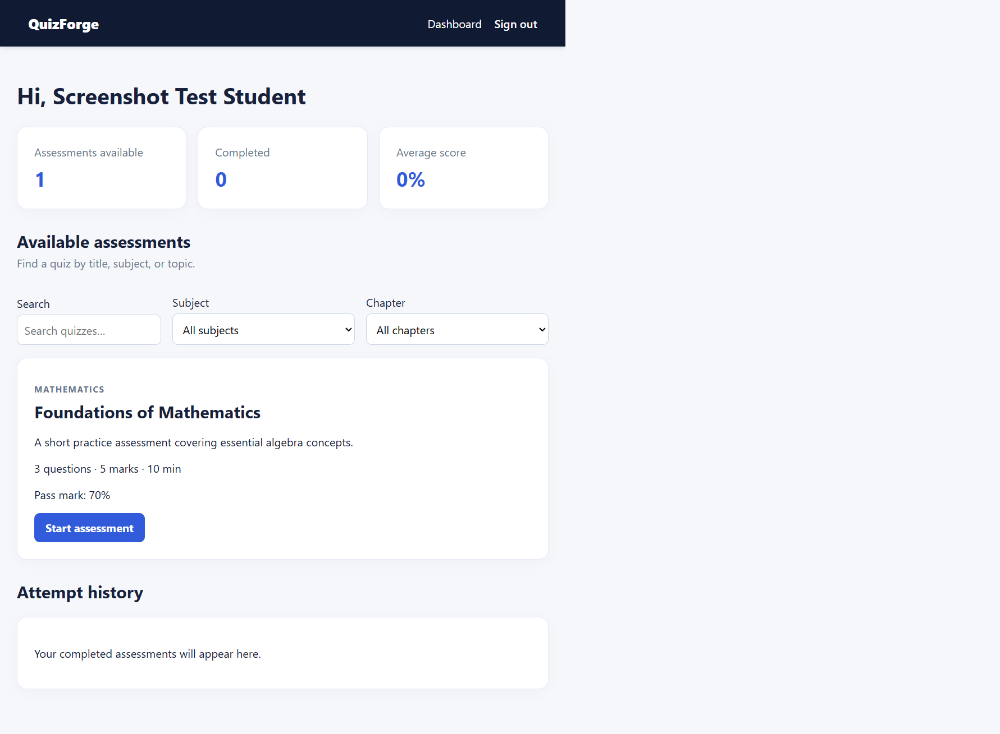
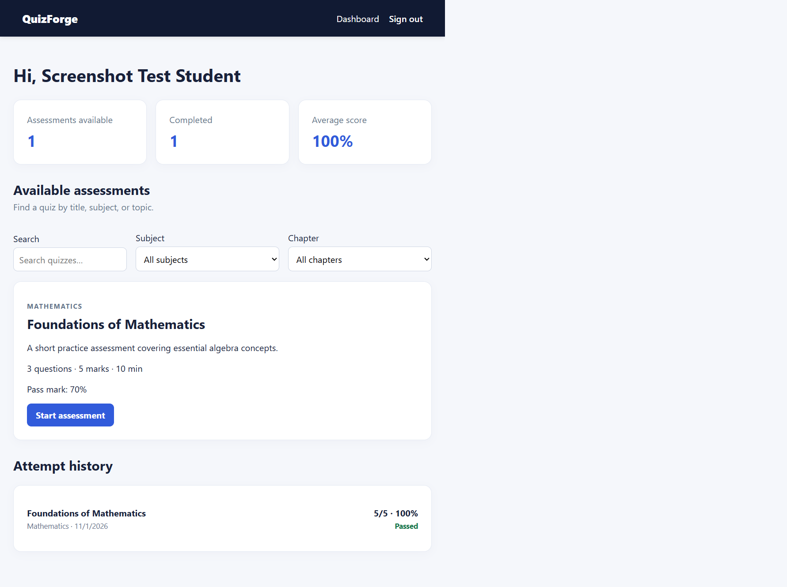

# Learnz — Quiz and Assessment Portal

Learnz is a formal, responsive full-stack MERN assessment platform for schools, coaching centres, and independent learners. Students register, take timed multiple-choice assessments, receive server-calculated results, and review their attempt history. Administrators manage curriculum subjects, chapter details, quizzes, questions, pass criteria, and feedback.

## Features

- JWT authentication with bcrypt password hashing and student/admin authorization
- Quiz and question CRUD with publishing workflow
- Subject catalogue with subject descriptions, syllabus chapters, and detailed chapter guidance
- Subject and topic tags, subject filtering, and quiz search
- Timed MCQ assessment experience with navigation, saved selections, and automatic submission
- Per-question marks, configurable pass percentages, server-side grading, and persistent pass/fail attempt history
- Detailed answer review after submission and student progress summaries
- Responsive React UI built with hooks, React Router, reusable form/layout components, and Axios API integration
- Validation, rate limiting, Helmet headers, Mongo query sanitization, CORS, and clear API error responses

## Screenshots

Run the app locally and open `http://localhost:5173` to view the student dashboard, assessment workspace, result screen, and administrator quiz editor. The interface is intentionally responsive for desktop and mobile widths.







## Quick start

### Prerequisites

- Node.js 20 or later
- MongoDB 7 or later, running locally, or a MongoDB Atlas connection string

### Configure

Copy the example environment files and update the values:

```powershell
Copy-Item server/.env.example server/.env
Copy-Item client/.env.example client/.env
```

Set a long, unique `JWT_SECRET` in `server/.env`. The server creates the configured admin account on first startup if it does not already exist.

### Install and run

```powershell
npm install
npm install --prefix server
npm install --prefix client
npm run dev
```

If you need to stop the local development stack manually, run `npm run stop`. Starting with `npm run dev` also clears prior QuizForge development processes so the API and client consistently use ports 5000 and 5173.

The client runs at `http://localhost:5173`; the API runs at `http://localhost:5000`.

### Local MongoDB

The app is configured to use `mongodb://127.0.0.1:27017/quiz-assessment-portal`. For this workstation, MongoDB Community Server is available as a portable local installation under the current user profile. Start it after a reboot with:

```powershell
.\scripts\start-local-mongo.ps1
npm run dev
```

The VS Code MongoDB extension can browse this database using `mongodb://127.0.0.1:27017`.

## Testing and production build

```powershell
npm test
npm run build
```

`npm test` runs the API health smoke test and produces a production client build in `client/dist`.

## API

All protected endpoints require `Authorization: Bearer <JWT>`.

| Method | Endpoint | Access | Purpose |
| --- | --- | --- | --- |
| POST | `/api/auth/register` | Public | Create a student account |
| POST | `/api/auth/login` | Public | Sign in |
| GET | `/api/auth/me` | Signed in | Current user |
| GET | `/api/quizzes` | Signed in | List quizzes (students see published only) |
| GET | `/api/quizzes/:id` | Signed in | Quiz detail; answers hidden from students |
| POST | `/api/quizzes` | Admin | Create a quiz |
| PUT | `/api/quizzes/:id` | Admin | Update a quiz |
| DELETE | `/api/quizzes/:id` | Admin | Delete a quiz and its attempts |
| POST | `/api/attempts/:quizId` | Student | Submit assessment answers |
| GET | `/api/attempts/my/history` | Student | Get attempt history |

## Deployment (Render + MongoDB Atlas)

The root [render.yaml](./render.yaml) defines a Render Blueprint for the Express API and the React static site, including the API health check and client-side route rewrites.

1. Create a MongoDB Atlas cluster and database user. Allow connections from your deployment host (for a quick Render setup, use Atlas IP access list `0.0.0.0/0` and a unique, least-privilege database user password). Copy the Atlas connection string and replace its `<password>` and database name.
2. In Render, choose **New → Blueprint**, connect `SHREYA-TIWARI12/quiz-assessment-portal`, and deploy the repository's `render.yaml`.
3. When prompted, enter `MONGODB_URI`, `ADMIN_EMAIL`, and a strong unique `ADMIN_PASSWORD`. Render generates the JWT secret; do not commit credentials.
4. Wait for `quizforge-api` and `quizforge-client` to finish deploying. The app will be at `https://quizforge-client.onrender.com`; the API health check is at `https://quizforge-api.onrender.com/api/health`.
5. Sign in with the administrator email and password configured in Render, then create and publish quizzes from **Manage quizzes**.

The Blueprint uses Render's free plans, which may sleep when idle and take longer to answer the first request after inactivity. If Render assigns different service URLs, update the API's `CLIENT_URL` and the client's `VITE_API_URL` environment variables to match, then redeploy the client. Never commit `.env` files or database credentials.
